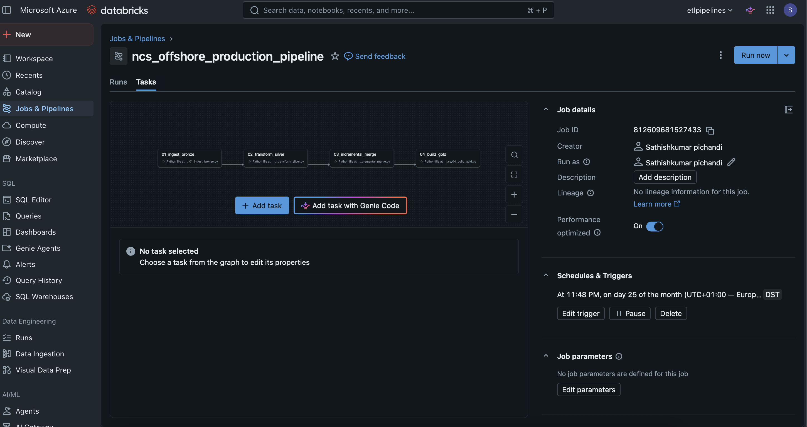

# Norwegian Offshore Continental Shelf (NCS) Asset & Production Lakehouse

An enterprise-grade Lakehouse pipeline built on **Azure Databricks**, **PySpark**, and **Delta Lake**, ingesting and curating monthly offshore production metrics from the Norwegian Offshore Directorate (Sodir).

---

## 🏛 Architecture Diagram
[ Norwegian Offshore Directorate Open Data ]
│
▼
[ Bronze Layer: Partitioned Raw Ingestion (CSV) ]
│
▼ (PySpark Cleaning & Schema Contract)
[ Silver Layer: Partitioned Delta Lake Table ]
│
▼ (ACID MERGE INTO & Deduplication)
[ Incremental Upserts (Idempotent Writes) ]
│
▼ (Star Schema Modeling)
[ Gold Layer: Dim Field & Fct Production Marts ]
│
▼
[ Databricks SQL / Automated pytest Validation Suite ]

---

## 🚀 Key Engineering Highlights

* **Medallion Lakehouse Architecture:** Follows industry-standard Bronze, Silver, and Gold segregation.
* **Idempotent ACID Upserts:** Uses Delta Lake `MERGE INTO` matching on composite keys `(field_name, production_year, production_month)` to eliminate duplicate records and redundant full-table rewrites.
* **Dimensional Modeling:** Produces a Kimball Star Schema with derived energy metrics:
  * `dim_field`: Asset metadata and operator ownership.
  * `fct_monthly_production`: Production volumes (Net Oil Sm3, Gas BSm3, Water Cut %, and BOE).
* **Automated Data Quality & Contracts:** Continuous automated assertions using `pytest` ensuring no negative volumetric reporting, strict bounded water cut percentages (0–100%), and referential integrity.
* **CI/CD Integration:** Automated GitHub Actions runner validating all pipeline stages and unit tests on every pull request.

---
### 📸 Orchestrated Production Workflow (Databricks Job DAG)



## 🛠 Local Setup & Reproduction

```bash
# Clone the repository
git clone [https://github.com/sathishpic22/ncs-lakehouse.git](https://github.com/sathishpic22/ncs-lakehouse.git)
cd ncs-lakehouse

# Setup virtual environment
python3 -m venv .venv
source .venv/bin/activate
pip install requests pyspark delta-spark pytest

# Run pipeline end-to-end
python 01_ingest_bronze.py
python 02_transform_silver.py
python 03_incremental_merge.py
python 04_build_gold.py

# Run test suite
pytest tests/

#### 3. Initialize Git and Push to GitHub
In your Terminal, run:

```bash
git init
git add .
git commit -m "feat: complete end-to-end NCS offshore production lakehouse with delta merge, tests, and CI/CD"
git branch -M main